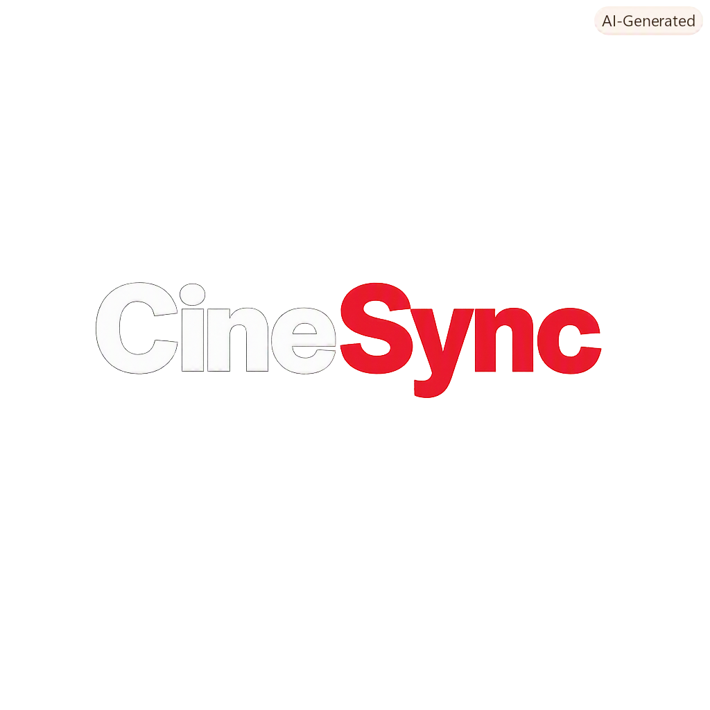

<p align="center">
  
</p>

<h1 align="center">CineSync</h1>

<p align="center">
  <b>Secure Movie Recommendation Engine</b>
</p>

---

A React + Vite web app that recommends movies from TMDb based on your preferences. All TMDb API calls route through a secure, protected backend layer keeping credentials strictly isolated from the client.

## Architecture

```text
Browser (React)  ──HTTP──▶  Express Backend  ──HTTPS──▶  TMDb API
                              │
                         .env (API key)
                         Protection Layer
The browser only interacts with internal API routes. The server handles external communication, data sanitization, and request management safely out of sight from client-side inspection.Quick StartBash# 1. Install dependencies
npm install

# 2. Start the backend server (port 3001)
npm run dev:server

# 3. In a second terminal, start the frontend (port 5173)
npm run dev
Open http://localhost:5173 — the frontend automatically proxies requests to the backend.Available ScriptsCommandDescriptionnpm run dev:serverStarts the Express backend on :3001npm run devStarts the Vite dev server on :5173npm run buildBuilds the frontend for productionnpm startRuns the backend in production modeEnvironment VariablesConfiguration variables live in the .env file at the root. These remain strictly server-side and are never exposed to frontend bundles.VariableRequiredPurposeTMDB_API_KEYYesExternal service authorization keyPORTNoCustom backend port (default: 3001)Security & ProtectionCineSync incorporates multiple layers of internal validation, request throttling, and header hardening to protect against abuse and unauthorized data access. All traffic is monitored and filtered before reaching external service providers.Project StructurePlaintextcinesync/
├── server.js              # Express backend
├── logo.png               # Project branding asset
├── .env                   # Configuration — SERVER-SIDE ONLY
├── package.json
├── vite.config.js         # Frontend config + proxy
├── tailwind.config.js
├── postcss.config.js
├── index.html
├── README.md
└── src/
    ├── main.jsx           # React entry point
    ├── index.css          # Tailwind + animations
    ├── App.jsx            # Root component
    └── components/
        ├── Hero.jsx       # Poster marquee + clock
        ├── SearchForm.jsx # User preference inputs
        └── Recommendation.jsx  # Result card
Production DeploymentFor deployment, you need to:Build the frontend: npm run buildServe dist/ as static files (Nginx, Vercel, Netlify)Run node server.js as your API serverPoint your static host to proxy /api/* to your serverOn Vercel/Netlify, you can deploy the Express backend as a serverless function or use their own serverless proxies.
